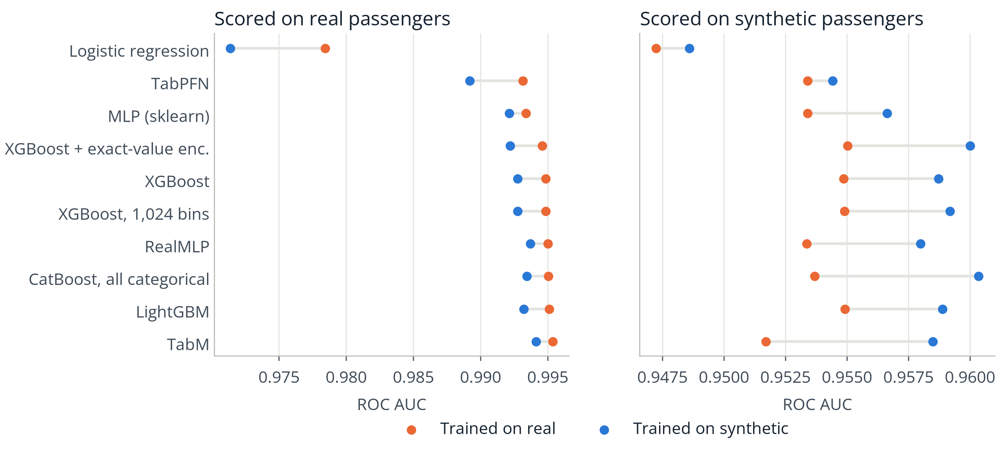
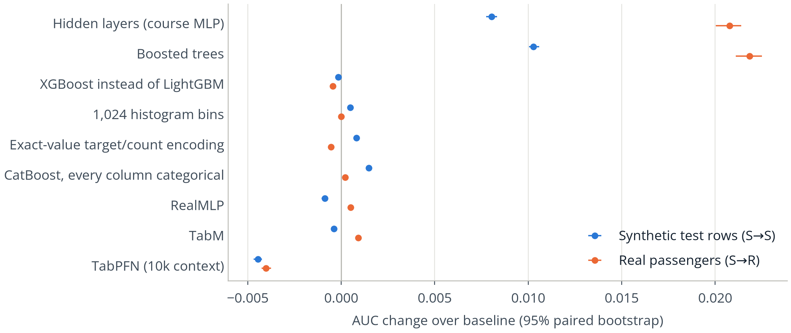
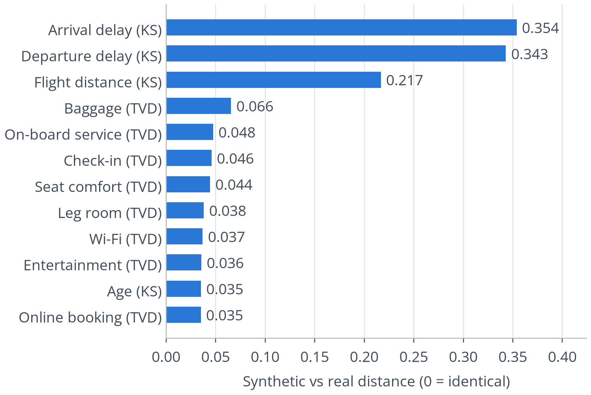
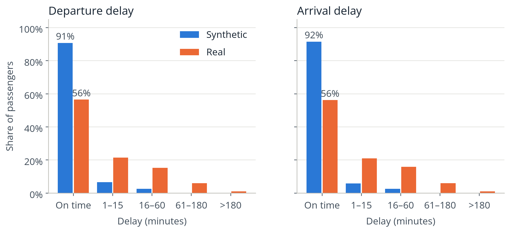
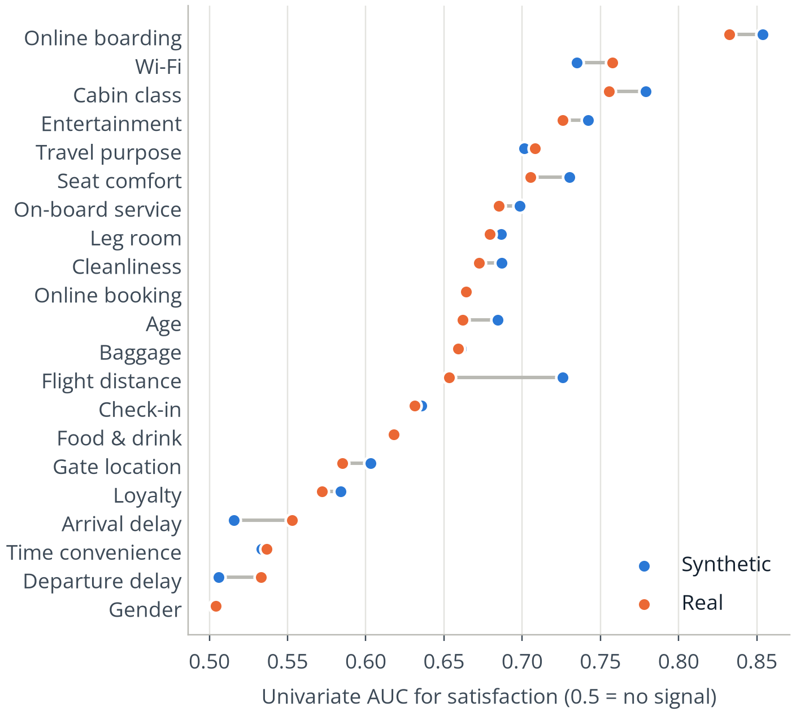
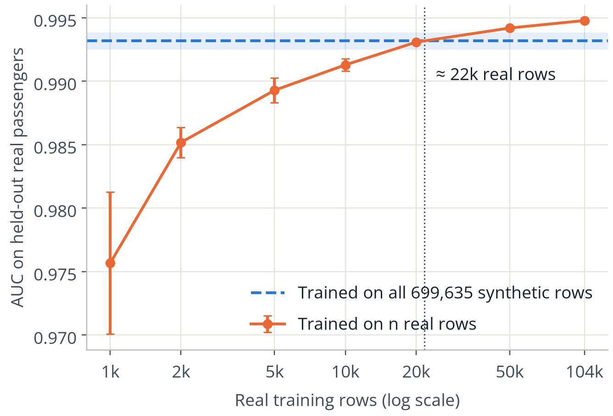
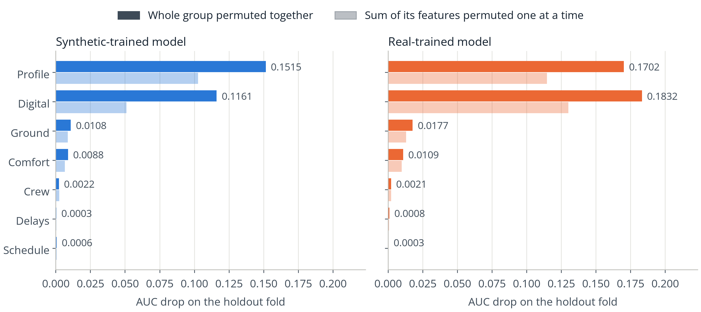
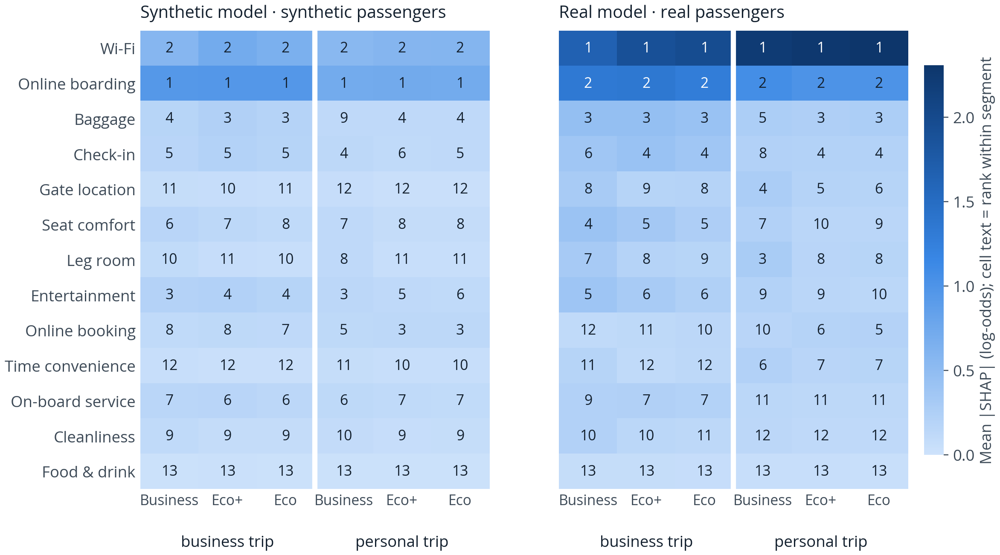
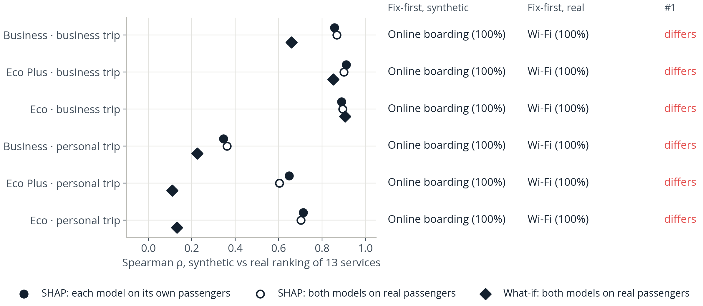
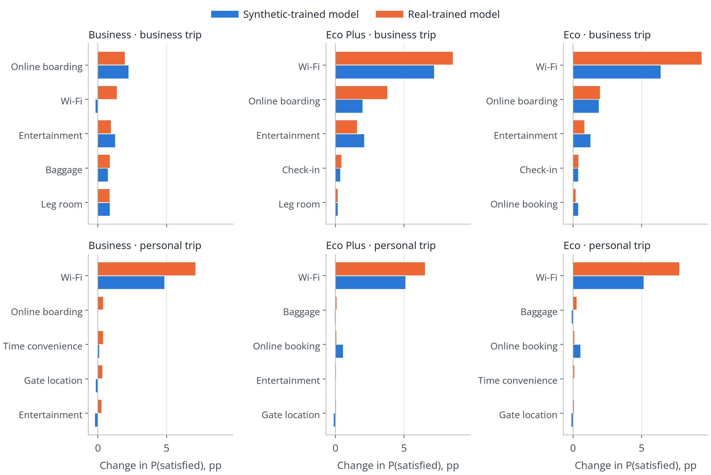

# Results

IS460 Group 03 · full-size runs of 25 Oct 2026 (SCIS GPU cluster). Methods and definitions are in
[`METHODOLOGY.md`](METHODOLOGY.md); every number here comes from `reports/results/*` written by the
scripts in `experiments/` and can be regenerated with the commands in §5. AUC = ROC AUC.
S = synthetic (Kaggle S6E10, 699,635 rows), R = real survey (129,880 rows); "S→R" = trained on
synthetic, scored on real.

## Answer in one paragraph

**Train on the synthetic copy if you must, but do not use it to choose or explain a model.** A model
trained on the 699,635 synthetic passengers scores real passengers almost as well as one trained on
real data (best S→R 0.9941 vs best R→R 0.9954). Yet the synthetic copy is worth only about 22,000
real passengers, it carries about 25 times more confidently wrong labels than the real survey, and it
picks the wrong model and the wrong "fix-first" service: synthetic cross-validation crowns the
Kaggle tricks that *hurt* real passengers (rank agreement with real, Kendall τ = 0.42), and SHAP on a
synthetic-trained model names *online boarding* as the top driver in all six traveller segments,
where the real survey names *in-flight Wi-Fi* in all six. A what-if analysis (raise one rating by a
point) is more robust: both models agree on the service to fix first in all six segments.

## 1. RQ1: which model would the synthetic copy have us deploy?

### 1.1 The ladder in four settings

Table 1. AUC of each model in each setting (rank in brackets). Models sorted by R→R.

| Model | S→S | R→R | S→R | R→S |
|---|---:|---:|---:|---:|
| TabM | 0.9585 (6) | **0.9954 (1)** | **0.9941 (1)** | 0.9517 (9) |
| LightGBM | 0.9589 (4) | 0.9951 (2) | 0.9932 (4) | 0.9549 (2) |
| CatBoost, all categorical | **0.9603 (1)** | 0.9950 (3) | 0.9934 (3) | 0.9537 (5) |
| RealMLP | 0.9580 (7) | 0.9950 (4) | 0.9937 (2) | 0.9534 (8) |
| XGBoost, 1,024 bins | 0.9592 (3) | 0.9949 (5) | 0.9928 (6) | 0.9549 (3) |
| XGBoost | 0.9587 (5) | 0.9948 (6) | 0.9928 (5) | 0.9549 (4) |
| XGBoost + exact-value encoding | 0.9600 (2) | 0.9946 (7) | 0.9922 (7) | **0.9550 (1)** |
| MLP (scikit-learn) | 0.9566 (8) | 0.9934 (8) | 0.9921 (8) | 0.9534 (7) |
| TabPFN (10k context) | 0.9544 (9) | 0.9931 (9) | 0.9892 (9) | 0.9534 (6) |
| Logistic regression | 0.9486 (10) | 0.9784 (10) | 0.9714 (10) | 0.9472 (10) |



*Figure 1. Each model scored on real passengers (left) and on synthetic passengers (right); colour =
training data. Real passengers are far easier to predict (≈ 0.995 vs ≈ 0.96) whichever data a model
was trained on. §2.3 shows why: the synthetic labels are noisy.*

Sanity checks against the proposal: logistic regression S→S 0.94859 and LightGBM S→S 0.95887 match
the proposal's numbers exactly; XGBoost raw, 1,024 bins and exact-value encoding differ by at most
0.0001 (GPU non-determinism).

### 1.2 Which techniques help real passengers?

Table 2. Paired change in AUC (×10⁻⁴) of each technique over its baseline, on the same rows,
95 % paired bootstrap interval (200 resamples). S→S is what a Kaggle leaderboard rewards; S→R is
what an airline would see.

| Technique (baseline → variant) | Δ S→S | Δ S→R |
|---|---:|---:|
| Boosted trees (logistic regression → LightGBM) | +102.8 [+100.3, +105.9] | +218.3 [+211.0, +225.0] |
| Hidden layers (logistic regression → MLP) | +80.4 [+77.5, +83.3] | +207.6 [+200.4, +213.9] |
| XGBoost instead of LightGBM | −1.6 [−2.6, −0.5] | −4.5 [−5.4, −3.7] |
| 1,024 histogram bins (XGBoost → XGBoost 1,024 bins) | **+4.7** [+3.9, +5.5] | −0.1 [−0.5, +0.3] |
| Exact-value target/count encoding (on top of 1,024 bins) | **+8.2** [+6.9, +9.3] | **−5.4** [−6.7, −4.3] |
| CatBoost with every column categorical (LightGBM → CatBoost) | **+14.7** [+13.2, +16.3] | +2.1 [+0.8, +3.8] |
| RealMLP (LightGBM → RealMLP) | **−8.9** [−10.6, −7.1] | **+4.9** [+3.6, +6.2] |
| TabM (LightGBM → TabM) | **−3.9** [−5.6, −2.2] | **+9.1** [+7.8, +10.2] |
| TabPFN, 10k context (LightGBM → TabPFN) | −44.6 [−46.9, −42.4] | −40.2 [−42.6, −37.5] |



*Figure 2. The same deltas as Table 2. Points right of zero help.*

- **The S6E10 forum's tricks exploit the generator.** Treating flight distance, age and delays as
  exact identifiers (finer bins, exact-value encoding, all-categorical CatBoost) is worth
  +4.7 to +14.7 ×10⁻⁴ on synthetic rows but between −5.4 and +2.1 on real passengers. Exact-value
  encoding is the clearest case: it is the second-best model on S→S and the worst tree model on
  real passengers (R→R and S→R).
- **Tabular neural nets go the other way.** RealMLP and TabM lose to LightGBM on synthetic rows but
  beat it on real passengers; TabM is the best single model in both real-scored settings.
- **The course methods matter most.** Moving from logistic regression to any non-linear model is
  worth 21–22 ×10⁻³ on real passengers, more than twenty times the largest later gain (TabM, +0.9 ×10⁻³).
- **TabPFN with a 10,000-row context is not competitive at this scale** (−0.004 everywhere); its
  context covers under 2 % of the synthetic training fold.

### 1.3 Ensembles

Table 3. Nested-CV ensembles of all ten models (rank mean, logistic stacking on logits, hill climbing).

| Trained on | Method | In-dataset AUC (nested) | Other dataset |
|---|---|---:|---:|
| Synthetic | Rank mean | 0.9595 | 0.9932 |
| Synthetic | Logistic stacking | **0.9608** | **0.9941** |
| Synthetic | Hill climbing | 0.9608 | 0.9940 |
| Real | Rank mean | 0.9949 | 0.9547 |
| Real | Logistic stacking | **0.9956** | 0.9534 |
| Real | Hill climbing | 0.9956 | 0.9537 |

Stacking adds +0.0005 over the best single model on synthetic rows (CatBoost 0.9603) and +0.0002 on
real ones (TabM 0.9954), but on real passengers the synthetic-trained stack (0.9941) is no better than
TabM alone (0.9941). Hill climbing on synthetic data picks CatBoost all-categorical, exact-value
XGBoost and TabM in equal parts (`reports/results/rq1_stacking.json`). Two of those three are the
artefact-exploiting models from Table 2; on real data hill climbing picks TabM (½), CatBoost (¼)
and LightGBM (¼).

### 1.4 Does synthetic cross-validation pick the right model?

Table 4. Agreement of the ten-model rankings between settings (`reports/results/rq2_ranking_agreement.csv`).

| Settings compared | Kendall τ | p | Spearman ρ | Same top model? |
|---|---:|---:|---:|---|
| S→S vs R→R | 0.42 | 0.11 | 0.56 | no (CatBoost vs TabM) |
| S→S vs S→R | 0.33 | 0.22 | 0.47 | no (CatBoost vs TabM) |
| **R→R vs S→R** | **0.82** | < 0.001 | **0.94** | **yes (TabM)** |
| R→R vs R→S | 0.11 | 0.73 | 0.16 | no |

When models are scored on real passengers, the training data barely changes the ranking (τ = 0.82).
When they are scored on synthetic passengers, the ranking is only loosely related to the real one
(τ = 0.42, not significant with ten models). **The synthetic copy is a usable training set but a poor
validation set.**

## 2. RQ2: what did the generator change, and what is the copy worth?

### 2.1 Distortion and detectability

- **Delays collapsed to zero.** 91.6 % of synthetic arrival delays are 0 minutes against 56.2 % of
  real ones (departure: 90.8 % vs 56.5 %); the mean arrival delay drops from 15.1 to 1.1 minutes
  (KS 0.35 and 0.34, the two largest distortions). The departure–arrival delay correlation falls
  from 0.74 to 0.47.
- **Flight distance is reshaped** (KS 0.22; mean 1,354 vs 1,190 miles). Every rating and
  categorical is within a total variation distance of 0.066.
- **Detectability.** A LightGBM separates synthetic from real rows with AUC 0.832 (3-fold, 100,000
  rows each); the synthetic train and test files are indistinguishable (0.498). The detector relies on
  arrival delay (29 % of gain), flight distance (25 %) and departure delay (18 %).
- **Not memorised.** Only 17 of 699,635 synthetic rows copy a real row on all 21 features.



*Figure 3. Per-feature distortion, synthetic vs real (KS for numerics, total variation distance otherwise).*



*Figure 4. Share of passengers per delay band.*

### 2.2 Dependence on the target

On equal-size samples (129,880 rows each), online boarding is the strongest single predictor in both
datasets. The largest gaps are flight distance (univariate AUC 0.726 synthetic vs 0.653 real, the
generator made it more predictive) and the delays (0.516 vs 0.553 arrival, 0.506 vs 0.533 departure,
the generator washed them out). The two digital ratings that matter for RQ3 moved in opposite
directions: online boarding became *more* predictive (0.854 vs 0.833) and in-flight Wi-Fi *less*
(0.735 vs 0.758).



*Figure 5. Univariate AUC of each feature for satisfaction, synthetic vs real.*

### 2.3 Label noise

Table 5. Rows on which a real-trained LightGBM (5-fold, R→R AUC 0.9951) is confident and disagrees
with the label.

| Confidence threshold | Synthetic rows flagged | Real rows flagged (out-of-fold) | Ratio |
|---|---:|---:|---:|
| p > 0.90 or < 0.10 | 4.33 % | 0.40 % | 11× |
| p > 0.95 or < 0.05 | 3.93 % | 0.16 % | 25× |
| p > 0.99 or < 0.01 | 3.34 % | 0.02 % | 207× |

About 4 % of synthetic passengers carry a label that their own answers contradict. This is the main
reason S→S AUC tops out near 0.96 while R→R reaches 0.995, and why a model that fits the synthetic
labels more closely (Table 2's tricks) does not improve on real passengers.

### 2.4 Utility: how many real passengers is the copy worth?

On real fold 0 (25,976 passengers) as a fixed test set, a LightGBM trained on all 699,635 synthetic
rows scores 0.9932 [0.9925, 0.9938]; one trained on the other 103,904 real rows scores 0.9948
(paired difference −0.0016 [−0.0019, −0.0013]). Reading the TSTR score off the real learning curve,
**the synthetic copy is worth about 21,700 real passengers** (95 % interval 16,000–37,100), i.e. one
synthetic row ≈ 0.03 real rows.



*Figure 6. Real-data learning curve (AUC on real fold 0) against the synthetic-trained model.*

## 3. RQ3: which service should an airline fix first, and for whom?

### 3.1 Service groups

Table 6. AUC drop when a whole service group is permuted on the holdout fold (LightGBM, fold 0).

| Group | Synthetic model | Real model |
|---|---:|---:|
| Digital (Wi-Fi, online booking, online boarding) | 0.116 (2nd) | **0.183 (1st)** |
| Profile (age, gender, loyalty, purpose, class, distance) | **0.152 (1st)** | 0.170 (2nd) |
| Ground (check-in, baggage, gate) | 0.011 | 0.018 |
| Comfort (seat, leg room, cleanliness, entertainment, food) | 0.009 | 0.011 |
| Crew (on-board service) | 0.002 | 0.002 |
| Delays | 0.0003 | 0.0008 |
| Schedule (time convenience) | 0.0006 | 0.0003 |

Permuting the Digital ratings together costs 2.3 times the sum of permuting them one at a time in the
synthetic model (1.4 times in the real model): the overlapping digital ratings hide each other, more
so in the synthetic copy. Delays barely matter in either model.



*Figure 7. Grouped vs one-at-a-time permutation importance.*

### 3.2 Fix-first by segment

- **SHAP disagrees in every segment.** Mean |TreeSHAP| ranks *online boarding* first in all six
  segments (cabin class × trip purpose) for the synthetic-trained model, and *in-flight Wi-Fi* first in
  all six for the real-trained model, each in 97–100 % of 200 bootstrap resamples. The disagreement
  stays when both models explain the same real passengers, so it comes from what the model learnt,
  not from who is explained. Spearman ρ between the two 13-service rankings is 0.86–0.91 for
  business travellers but 0.35–0.71 for personal travellers.
- **What-if agrees in every segment.** Raising one rating by a point (for passengers who rated it 1–3)
  and reading the change in predicted satisfaction gives the same fix-first service from both models
  in all six segments: Wi-Fi in five, online boarding for business-class business travellers. The
  synthetic model understates the size: a Wi-Fi upgrade adds 6.5–9.4 percentage points for economy
  and premium-economy passengers according to the real model, against 5.1–7.2 according to the
  synthetic one.



*Figure 8. Mean |SHAP| per service and segment (cell text = rank within segment).*



*Figure 9. Agreement of synthetic and real service rankings per segment, and the two fix-first lists.*



*Figure 10. Change in predicted P(satisfied) on real passengers when one rating rises by a point.*

The SHAP swap is consistent with §2.2: the generator strengthened the link between online boarding
and satisfaction and weakened Wi-Fi's, and the two ratings overlap (ρ = 0.44 real, 0.46 synthetic),
so the synthetic-trained model gives online boarding credit that the real model gives to Wi-Fi. What-if
asks a different question, "what if this rating were higher?", and is less sensitive to how credit is
split between correlated ratings. All of this is associational: it describes the models, not the
effect of actually improving a service.

## 4. What this means for an airline

| Decision | Can the synthetic copy be trusted? | Evidence |
|---|---|---|
| Train a satisfaction model | **Mostly.** Costs ≈ 0.0013–0.0019 AUC on real passengers vs real data | Table 1 (R→R vs S→R), §2.4 |
| Choose a model or technique | **No.** Rewards generator artefacts and ranks models differently | Tables 2 and 4 |
| Estimate real-world accuracy | **No.** S→S (0.96) understates real accuracy (0.995) because of label noise | Table 5 |
| Pick the service to fix first | **Only with a what-if analysis**, not with SHAP rankings | §3.2 |
| Plan around delays | **No.** Delays were collapsed by the generator | §2.1 |

## 5. Reproducibility and compute

```
python cluster/remote.py push --data && python cluster/remote.py setup
python cluster/remote.py submit --name full-a -- "python experiments/rq1_ladder.py --models logreg mlp lgbm xgb xgb_bins xgb_ev catboost_cat; python experiments/rq3_drivers.py; python experiments/rq2_fidelity.py --skip ranking"
python cluster/remote.py submit --name full-b -- "python experiments/rq1_ladder.py --models realmlp tabm tabpfn; python experiments/rq1_stacking.py; python experiments/rq1_report.py; python experiments/rq2_fidelity.py --steps ranking"
python cluster/remote.py fetch
```

Wall-clock on one RTX 3090 node (8 cores): tree models + RQ2 + RQ3 32 min; RealMLP 5.5 min, TabM 23 min,
TabPFN 32 min, stacking + report 22 min. A rerun of RQ2 and RQ3 reproduced every number above exactly.

## 6. Limitations

- **S→R is optimistic**: the real survey trained the generator, so S→R measures performance on the
  distribution the generator imitated, not on new passengers (METHODOLOGY §2, §8).
- **One split, one seed per model.** Paired bootstrap intervals cover row sampling, not refitting
  noise; differences under about 0.0005 should not be over-read.
- **Default hyper-parameters** in every setting; tuning on S could change the S→S ranking.
- **TabPFN** was limited to a 10k-row context; larger contexts or newer weights might change its rung.
- **Drivers are associational**; the what-if analysis is a model-based counterfactual, not a causal effect.
